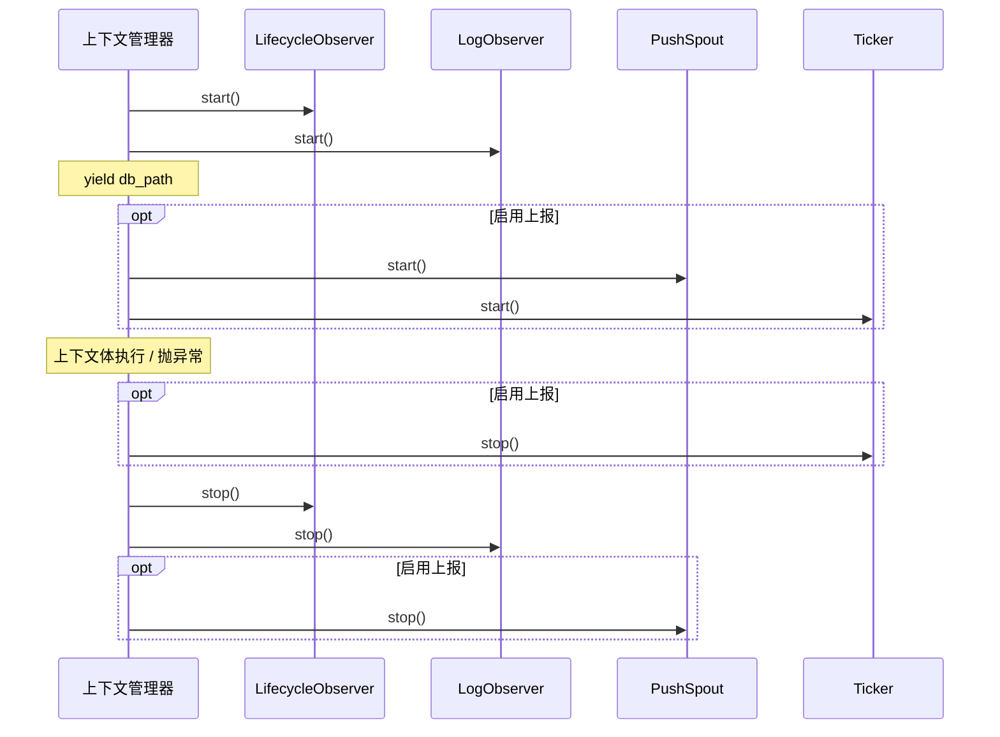

# tests/assembly/test_run.py

> 📅 最后更新日期: 2026/11/13

## 作用

验证 `celestialflow.assembly.core_run` 的两个运行期资源上下文管理器——`run_graph_resources` 与 `run_node_resources`——的资源装配、产出与回收语义：

- 进入上下文时启动持久化观察者并产出 lifecycle sqlite 数据库路径；
- 按 `log_level` 构造并注册 `LogObserver`；
- 图入口在 `report` 存在时装配推送通道、快照处理器与快照节拍器，在 `report is None` 时完全不创建推送资源；
- 退出（包括上下文体内抛异常）时按正确顺序停止节拍器、推送 spout 与生命周期 / 日志观察者。

> 当前实现通过私有 `_persistence_resources` 统一装配 `LifecycleObserver` 与 `LogObserver`，不再直接创建 `LifecycleSpout` / `LogSpout` / `LifecycleInlet` / `LogInlet`。测试断言的是观察者层面的启停与注册，而非旧版 inlet/spout 配对。

## 核心测试对象

| 对象 | 来源 | 说明 |
|------|------|------|
| `run_graph_resources(observers, injection_target, *, log_level, report)` | `celestialflow.assembly.core_run` | 图运行期资源入口，产出 `db_path` |
| `run_node_resources(observers, *, log_level)` | `celestialflow.assembly.core_run` | 单节点运行期资源入口，产出 `db_path` |
| `_persistence_resources(observers, metrics_view, log_level)` | `celestialflow.assembly.core_run`（私有） | 创建并启动 `LifecycleObserver` / `LogObserver`，退出时先停 lifecycle 再停 log |
| `LifecycleObserver` / `LogObserver` | `celestialflow.persist.core_lifecycle` / `celestialflow.persist.core_log` | 被测入口装配的持久化观察者 |
| `MetricsObserver` / `ObserverHub` | `celestialflow.observer` | 指标写模型与观察者容器 |
| `PushSpout` / `PushInlet` / `PushSnapshotHandler` | `celestialflow.reporter` | 启用上报时的推送通道与观察者 |
| `Ticker` / `ReportConfig` / `DEFAULT_REPORT_URL` | `celestialflow.ticker` / `celestialflow.runtime.core_config` | 快照节拍器与上报配置 |
| `InvalidOptionError` | `celestialflow.runtime.util_errors` | 非法 `log_level` 的预期异常 |

## 关键 fixture 与替身

| 名称 | 类型 | 用途 |
|------|------|------|
| `tmp_path` + `monkeypatch.chdir(tmp_path)` | pytest 内建 | 把工作目录切到临时目录，使 `./lifecycles/...` 下的 sqlite 文件落在临时路径 |
| `ObserverHub._snapshot()` | 被测库内部接口 | 读取当前已注册观察者元组，用于断言数量、类型与注册顺序 |
| `_InjectionTarget` | 测试内替身 | 满足 `InjectionTarget` 协议的最小实现，`inject_tasks` / `inject_terminations` 均为空操作 |
| `_RecordingLifecycleObserver` / `_RecordingLogObserver` | 测试内子类 | 覆写 `stop()`，在调用 `super().stop()` 后向 `stopped` 列表追加 `'lifecycle'` / `'log'` |
| `_RecordingPushSpout` | 测试内子类 | 覆写 `__init__`，记录构造次数（`used.append('push')`）与实际 `base_url` |
| `_RecordingTicker` | 测试内子类 | 覆写 `start()` / `stop()`，记录 `'ticker-start'` / `'ticker-stop'` |
| `monkeypatch.setattr(core_run, ...)` | pytest 内建 | 替换 `core_run` 模块命名空间中的 `LifecycleObserver` / `LogObserver` / `PushSpout` / `Ticker`，从而拦截被测入口内部构造 |

## 测试覆盖矩阵

### `TestGraphRunResources` — 图入口

| 用例 | 覆盖目标 |
|------|---------|
| `test_yields_db_path_and_registers_observers` | 进入时产出存在的 sqlite 路径；默认注册 3 个观察者（指标 + lifecycle + log） |
| `test_stops_spouts_on_exit` | 退出时 lifecycle 与 log 观察者都被 `stop()` |
| `test_cleans_up_when_body_raises` | 上下文体抛 `RuntimeError` 时异常向外传播，且持久化观察者仍被回收 |
| `test_uses_push_spout_when_report_enabled` | 传入 `ReportConfig(url=...)` 时创建 `PushSpout`，并使用该地址 |
| `test_no_push_spout_when_report_disabled` | 未传 `report` 时不创建任何推送 spout |
| `test_uses_default_url_when_report_enabled_without_url` | `ReportConfig()` 使用 `DEFAULT_REPORT_URL` 构造 `PushSpout` |
| `test_registers_snapshot_handler_before_push_inlet` | `PushSnapshotHandler` 在 `PushInlet` 之前注册，保证终态快照先于下线通知入队 |
| `test_starts_and_stops_snapshot_ticker_when_report_enabled` | 启用上报时构造 spout → 启动 ticker → 退出时停止 ticker |
| `test_log_level_argument` | `log_level='error'` 被规范化为 `'ERROR'` 并传给 `LogObserver` |
| `test_rejects_invalid_log_level` | 非法级别（`'VERBOSE'`）抛出 `InvalidOptionError` |

### `TestNodeRunResources` — 节点入口

| 用例 | 覆盖目标 |
|------|---------|
| `test_registers_metrics_and_inlets` | 节点入口内部创建 `MetricsObserver`，连同 lifecycle / log 共 3 个观察者，并产出 `db_path` |
| `test_log_level_argument` | `LogObserver.log_level == 'ERROR'` |
| `test_rejects_invalid_log_level` | 非法级别抛出 `InvalidOptionError` |
| `test_stops_spouts_on_exit` | 退出时 lifecycle / log 都被停止 |

## 关键行为细节

### 观察者注册顺序

图入口的注册顺序固定为：

1. `MetricsObserver`（入口内部创建）
2. `LifecycleObserver`
3. `LogObserver`
4. `PushSnapshotHandler`（仅启用上报）
5. `PushInlet`（仅启用上报）

`test_registers_snapshot_handler_before_push_inlet` 取 `_snapshot()` 中各观察者的类型名列表，断言 `PushSnapshotHandler` 的下标小于 `PushInlet`。这一顺序对应 `core_run` 中先 `observers.add_observer(snapshot_handler)` 再 `observers.add_observer(push_inlet)` 的实现：`GraphEndEvent` 分发时快照记录先入队，随后才是 `/api/shutdown_session` 下线记录。

### 资源启停顺序



- ticker 在 `try/finally` 中先停，之后才退出 `_persistence_resources` 并停止 lifecycle / log，最后在最外层 `finally` 停止 `push_spout` 并关闭 `requests.Session`。这样节拍线程不会在观察者/spout 已关闭后继续入队。
- `test_starts_and_stops_snapshot_ticker_when_report_enabled` 的断言是 `events == ['push', 'ticker-start', 'ticker-stop']`。注意 `_RecordingPushSpout` 只在**构造**时记录 `'push'`，并不记录 `start()`；`_RecordingTicker` 记录 start/stop。因此该断言证明的是“先构造 spout，再启动/停止 ticker”。
- 停止顺序在 `test_stops_spouts_on_exit` 中用 `set(stopped) == {'lifecycle', 'log'}` 断言，只验证两者都被回收，不约束二者的相对顺序（实现上为 lifecycle → log）。

### `db_path` 产出

`run_graph_resources` / `run_node_resources` 均把 `lifecycle.db_path` 作为上下文值产出。`LifecycleObserver.start()` 触发其内部 spout 的 `_before_start()`，在 `./lifecycles/<YYYY-MM-DD>/flow_lifecycle(<HH-MM-SS-毫秒>).sqlite3` 创建数据库并赋给 `db_path`。测试在 `monkeypatch.chdir(tmp_path)` 后断言 `db_path is not None` 且 `Path(db_path).exists()`。

### 上报配置分支

| `report` 取值 | 创建的推送资源 |
|---------------|----------------|
| `None`（默认） | 无 `PushSpout`、无 `PushInlet`、无 `PushSnapshotHandler`、无 `Ticker` |
| `ReportConfig()` | `PushSpout(session_id, DEFAULT_REPORT_URL)` + `PushInlet` + `PushSnapshotHandler` + `Ticker(1.0, hub, name="report")` |
| `ReportConfig(url=...)` | 同上，`base_url` 使用显式地址 |

测试通过替换 `core_run.PushSpout` 为记录子类来观测构造调用与实际 URL，不会发出真实 HTTP 请求；`PushSpout` 内部创建的 `requests.Session` 在退出时被关闭。

### 日志级别

两个入口都在最前面调用 `normalize_log_level(log_level)`：去空白并转大写，非法值抛 `InvalidOptionError`。因此 `log_level='error'` 最终写入 `LogObserver.log_level == 'ERROR'`。`run_node_resources` 的该断言位于上下文体内，`run_graph_resources` 则在上下文体内筛选 `LogObserver` 实例。

## 运行方式

```bash
# 全部执行
uv run pytest tests/assembly/test_run.py -v

# 仅图入口
uv run pytest tests/assembly/test_run.py -k "TestGraphRunResources" -v

# 仅节点入口
uv run pytest tests/assembly/test_run.py -k "TestNodeRunResources" -v

# 仅上报相关
uv run pytest tests/assembly/test_run.py -k "report or push or ticker" -v
```

## 注意事项

- 测试不启动真实任务图，只验证资源装配与生命周期；注入目标使用 `_InjectionTarget` 空实现。
- 所有替换都打在 `core_run` 模块命名空间上（`monkeypatch.setattr(core_run, 'Ticker', ...)`），因此被测入口内部的引用会被拦截；直接替换 `celestialflow.ticker.Ticker` 不会生效。
- 事件顺序断言依赖“`PushSpout` 在 `Ticker` 之前构造、`push_spout.start()` 在 `ticker.start()` 之前调用”这一实现细节；若调整装配顺序需同步更新该用例。
- 相关实现见 `src/celestialflow/assembly/core_run.py`，资源语义另见 `docs/zh-CN/src/assembly/core_run.md`。
