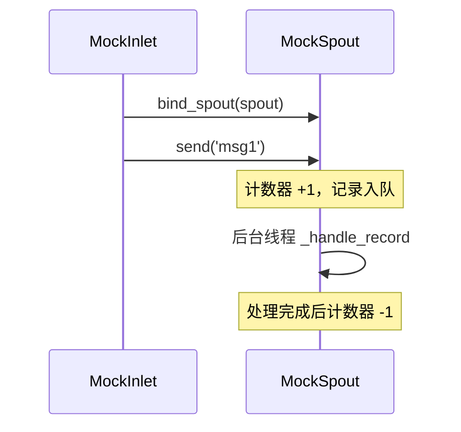

# tests/funnel/test_inlet.py

> 📅 最后更新日期: 2026/11/13

## 作用

验证 `celestialflow.funnel.core_inlet.BaseInlet` 的最小职责：通过 `send(record)` 把记录放入已绑定 spout 的队列，并推进待处理计数，最终被运行中的 `BaseSpout` 子类消费。

## 覆盖点

- `MockInlet.send()` 直接复用 `BaseInlet.send()`，把记录放入目标队列。
- `MockSpout` 从队列消费字符串与字典两类消息。
- 未启动消费者时，记录仍会进入队列，且 `get_pending_count()` 增加，供后续读取。
- `bind_spout()` 返回与目标 spout 共享队列 / 计数器的 inlet，且自身类型保持为子类（`MockInlet`）。

## 测试覆盖矩阵

| 测试类 | 用例 | 覆盖目标 |
|--------|------|----------|
| `TestBaseInlet` | `test_inlet_to_spout_communication` | 启动 spout 后，inlet 依次发送 `'msg1'` 与 `{'key': 'val'}`，最终按顺序被消费且待处理计数归零 |
| `TestBaseInlet` | `test_send_puts_record_into_queue` | 未启动 spout 时 `send()` 把原始记录放入 `get_queue()`，`get_pending_count() == 1` |
| `TestBaseInlet` | `test_bind_spout_creates_bound_inlet` | `bind_spout()` 返回 `MockInlet` 实例，且发送后共享同一 spout 的队列与计数 |

## 关键行为



- `send()` 在入队前先自增 `PendingCounter`，入队失败会回滚计数；未绑定 spout 时抛 `InitializationError`。
- `get_pending_count()` 统计的是"已入队但尚未处理完成"的记录数，因此包含已出队、仍在处理中的记录。

## 运行方式

```bash
pytest tests/funnel/test_inlet.py -v
pytest tests/funnel/test_inlet.py -k "communication" -v
```

## 注意事项

- `wait_until` 来自根级 `tests/conftest.py`，用于等待后台消费完成，避免固定 `sleep`。
- 所有记录都是原地透传，`BaseInlet` 不做序列化或转换。
