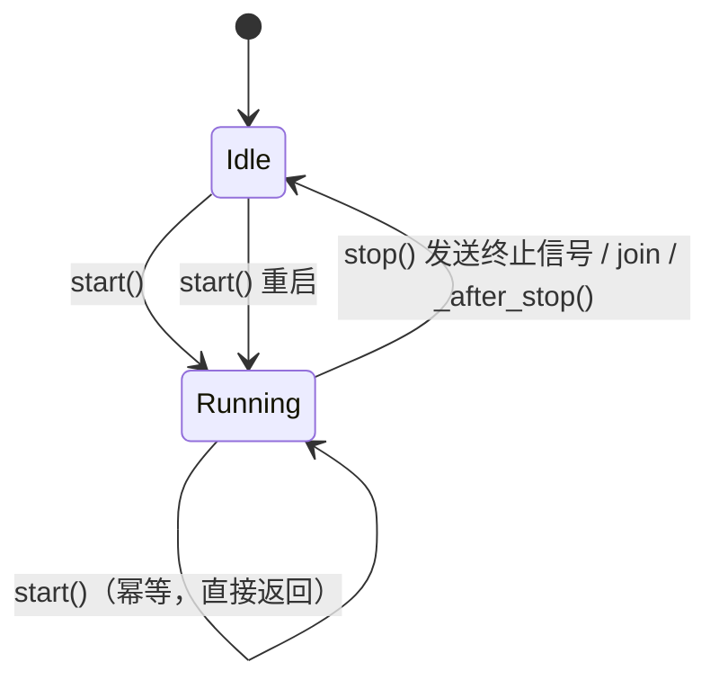

# tests/funnel/test_spout.py

> 📅 最后更新日期: 2026/11/13

## 作用

验证 `celestialflow.funnel.core_spout.BaseSpout` 的生命周期钩子、启动幂等、终止信号处理与抽象方法约束，确保后台监听线程能够按预期启动、停止、重启并消费停止前的记录。

## 覆盖点

- `start()` 在首次启动时调用 `_before_start()`；重复 `start()` 不会重复执行 `_before_start()`（幂等）。
- `stop()` 会发送终止信号、等待线程结束并触发 `_after_stop()`，停止后不再消费新记录。
- `stop()` 支持重复调用，重复调用不会引发异常。
- `stop()` 之后可再次 `start()`，重启后的 spout 仍能继续消费新记录。
- 基类未实现 `_handle_record()` 时应抛出 `CelestialFlowError`。

## 测试覆盖矩阵

| 测试类 | 用例 | 覆盖目标 |
|--------|------|----------|
| `TestBaseSpout` | `test_start_is_idempotent` | 连续调用两次 `start()`，`_before_start()` 只执行 1 次 |
| `TestBaseSpout` | `test_base_spout_lifecycle` | `start()` 触发 `_before_start()`，停止前的数据被消费；`stop()` 触发 `_after_stop()`，之后入队的数据不再被消费 |
| `TestBaseSpout` | `test_spout_termination_signal` | 终止信号前的两条记录全部处理，`stop()` 后待处理计数归零、重复 `stop()` 安全 |
| `TestBaseSpout` | `test_spout_can_restart_after_stop` | `stop()` 后再次 `start()` 重新创建后台线程，并能继续消费 `"second"` |
| `TestBaseSpout` | `test_spout_not_implemented_error` | 未覆写 `_handle_record()` 时抛 `CelestialFlowError`，消息含 `_handle_record must be implemented` |

## 关键流程



- `start()` 先检查 `_thread` 是否存活，存活时直接返回；否则执行 `_before_start()` 后创建 daemon 线程。
- `stop()` 向队列写入 `TERMINATION_SIGNAL`，`join(timeout=5)`；超时未退出抛 `RuntimeStateError`。终止后队列中的新记录不会被消费（`get_pending_count()` 保持为 1）。
- 后台循环中单条记录处理失败只打印回溯，不会杀死线程；无论成功与否都会递减待处理计数。

## 运行方式

```bash
pytest tests/funnel/test_spout.py -v
pytest tests/funnel/test_spout.py -k "lifecycle or termination or idempotent" -v
```

## 注意事项

- `wait_until` 与 `assert_stays_true` 来自根级 `tests/conftest.py`，分别用于等待消费完成和验证停止后不再消费。
- `assert_stays_true` 在 `duration=0.3` 内持续采样，避免只做一次性检查导致的时序漏判。
