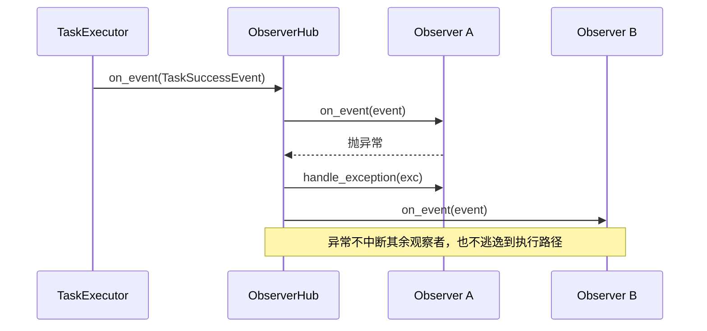

# tests/observer/test_observer.py

> 📅 最后更新日期: 2026/11/13

## 作用

验证 `celestialflow.observer` 中统一事件模型（`Event` 基类 + `Observer.on_event(event)`）、观察者分发中心 `ObserverHub`（含 `find()` 查找）、内置 `PrintObserver` 与运行节点 / 任务图（`TaskExecutor` / `TaskGraph` / `TaskChain`）之间的契约：确保任务执行生命周期中的各类事件都能正确送达观察者，hub 能隔离单个观察者的异常，图级观察者能收到全部节点事件与图启动 / 结束事件。

## 核心测试对象

| 类 / 对象 | 来源 | 说明 |
|-----------|------|------|
| `Event` | `celestialflow.observer` | 所有观测事件的不可变基类（`__slots__ = ()`），本身不携带状态 |
| `Observer` | `celestialflow.observer` | 观察者基类，只有 `on_event(event)` 与 `handle_exception(exception)` 两个回调；子类在 `on_event` 中用 `match` 按事件类型分派 |
| `ObserverHub` | `celestialflow.observer` | 本身即 `Observer`，按注册顺序广播 `on_event`；提供 `add_observer()`、`find(type)`、`handle_exception()`；拒绝循环注册 |
| `PrintObserver` | `celestialflow`（`celestialflow.observer` 亦导出） | 内置标准输出观察者，构造参数为 `name`，维护 `total` / `succeeded` / `failed` / `skipped` 计数 |
| `MetricsObserver` | `celestialflow.observer` | 指标观察者，测试经 `metrics_of(executor)` 读取节点指标 |
| `TaskExecutor` / `TaskGraph` / `TaskChain` | `celestialflow` | 运行宿主，在生命周期中向 `observers.on_event(...)` 推送事件 |
| 事件类型 | `celestialflow.observer` | `NodeStartEvent` / `NodeEndEvent` / `TaskInputEvent` / `TaskSuccessEvent` / `TaskFailEvent` / `TaskSkipEvent` / `TaskRetryEvent` / `TerminationInputEvent` / `TerminationMergeEvent` / `GraphStartEvent` / `GraphEndEvent` |

## 测试辅助对象

| 对象 | 说明 |
|------|------|
| `RecordingObserver` | 继承 `Observer`，覆写 `on_event()` 把收到的全部事件追加到 `events` 列表，供按类型筛选断言 |
| `_only(events, event_type)` | 从事件列表中筛出指定类型（`isinstance`）的事件 |
| `CountObserver` / `SkipObserver` / `Counter` / `Tagged` 等 | 用例内定义的局部观察者，用 `match` 只关心特定事件类型 |
| `RetryOnceThenSucceed` | 首次抛 `ValueError`、第二次返回 `x + 1` 的可重试函数对象 |

## 测试覆盖矩阵

### `TestExecutorObserver` — 执行器事件

| 用例 | 覆盖目标 |
|------|---------|
| `test_observer_receives_full_lifecycle` | 串行执行 3 个任务：1 个 `NodeStartEvent`、3 个 `TaskInputEvent`、3 个 `TaskSuccessEvent`、1 个 `NodeEndEvent`；外部输入 `from_node is None`；`NodeEndEvent` 是最后收到的事件 |
| `test_task_success_event_carries_payload_and_ids` | `TaskSuccessEvent` 携带 `task` / `result` / `node`，且 `success_id > task_id` |
| `test_print_observer` | `PrintObserver("PrintObserverTest")` 输出 `[PrintObserverTest] start` / `finish`，`total=3` / `succeeded=2` / `failed=1` |
| `test_observer_with_errors` | 3 个任务中 2 成功 1 失败，`TaskSuccessEvent` / `TaskFailEvent` 计数准确 |
| `test_observer_receives_skip_callback` | `skip_func=lambda x: x == 0` 时收到 1 个 `TaskSkipEvent` |
| `test_no_observer_works` | 未挂载观察器时执行器正常运行，`metrics_of(executor).get_node_metrics(name).succeeded == 3` |
| `test_multiple_observers` | 两个观察器同时收到相同事件 |
| `test_task_input_reports_upstream_source` | 任务图中上游下发的任务触发 `TaskInputEvent`，其 `node == "down"`、`from_node == "up"` |

### `TestExtendedObserver` — 重试与终止信号

| 用例 | 覆盖目标 |
|------|---------|
| `test_observer_receives_retry_and_termination_events` | `max_retries=1` + `set_retry_exceptions(ValueError)` 下收到 1 个 `TaskRetryEvent`（`retry_times == 1`）、1 个 `TerminationInputEvent`、1 个 `TerminationMergeEvent` |

### `TestObserverHub` — 分发与查找

| 用例 | 覆盖目标 |
|------|---------|
| `test_hub_explicitly_overrides_every_observer_method` | 防止转发漂移：`Observer` 中所有 `on_*` 方法（当前仅有 `on_event`）都必须在 `ObserverHub` 中显式定义 |
| `test_hub_isolates_observer_exception` | 一个观察者在 `TaskSuccessEvent` 上抛 `RuntimeError` 时，其余观察者仍收到全部事件；异常经 `handle_exception` 打印到 stderr |
| `test_hub_handle_exception_backstops_failing_observer_handler` | 观察者的 `handle_exception` 自身再抛异常时，由 hub 的 `handle_exception` 兜底；stderr 同时出现 `observer boom` 与 `handler boom`，分发不中断 |
| `test_hub_rejects_cyclic_registration` | 拒绝 hub 注册自身、以及 A→B 后 B→A 的循环注册，均抛 `ConfigurationError` |
| `test_find_returns_direct_observer` | `find(RecordingObserver)` 命中本层直接注册的实例 |
| `test_find_returns_none_when_missing` | 无匹配类型时 `find()` 返回 `None` |
| `test_find_recurses_into_nested_hub` | 匹配项只存在于嵌套 hub 时，`find()` 递归查找并返回该实例 |
| `test_find_prefers_direct_registration_over_nested` | 本层直接注册的观察者优先于嵌套 hub 中的同类型实例 |
| `test_find_matches_subclass` | `find()` 使用 `isinstance` 匹配，子类实例同样命中 |
| `test_find_returns_first_registered_match` | 同层多个匹配时返回最先注册的实例 |

### `TestGraphObserver` — 图级观察者

| 用例 | 覆盖目标 |
|------|---------|
| `test_graph_observer_receives_all_nodes` | 图级观察者收到 `up` / `down` 两个节点的启动 / 结束事件；`TaskInputEvent` 中 `("up", None)` 与 `("down", "up")` 各 2 次；共 4 个 `TaskSuccessEvent` |
| `test_node_local_observer_runs_before_graph_observer` | 同一节点内，节点本地观察者先于图级观察者收到事件（顺序 `["node", "graph"]`） |
| `test_graph_hub_is_injected_as_object` | 注入的是 hub 对象本身：`run` 之后再注册的图级观察者也生效；用例通过 `node.observers.on_event(TaskSuccessEvent(...))` 手动触发验证 |
| `test_run_async_injects_graph_observers` | `run_async` 路径同样完成图级观察者注入 |
| `test_graph_observer_receives_graph_events` | 收到 1 个 `GraphStartEvent` 与 1 个 `GraphEndEvent`；启动事件携带 `graph` / `graph_mode` / `is_dag` / `nodes` / `edges` / `source_nodes` / `node_meta`，其中 `node_meta["only"]["class_name"] == "TaskExecutor"` |
| `test_structure_supports_graph_observer` | 结构类 `TaskChain` 同样支持图级观察者 |
| `test_graph_rejects_cycle_between_graph_and_node_hub` | 把 node hub 注册进 graph hub 后，`graph.run()` 注入时因循环引用抛 `ConfigurationError` |

## 事件分发与查找流程

```mermaid
flowchart LR
    Node[TaskExecutor] -->|on_event| NH[节点 ObserverHub]
    Graph[TaskGraph] -->|注入 hub| NH
    NH -->|直接注册| L[节点本地观察者]
    NH -->|嵌套 hub| GH[图级 ObserverHub]
    GH --> G[图级观察者]
    Q[hub.find(type)] -->|先本层| NH
    NH -->|未命中再递归| GH
```



## 测试重点

- **统一入口**：所有事件都经 `on_event(event)` 分发，观察者用 `match` 按具体事件类型处理，不再有逐事件回调方法。
- **事件顺序**：`NodeStartEvent` 最先、`NodeEndEvent` 最后；节点本地观察者先于图级观察者。
- **载荷与 ID**：成功事件携带任务、结果与独立的 `task_id` / `success_id`（递增）。
- **原因追溯**：上游投递的任务通过 `TaskInputEvent.from_node` 标识来源节点。
- **hub 异常隔离**：单个观察者抛异常（含 `handle_exception` 自身抛异常）不影响其余观察者，也不中断分发。
- **查找语义**：`find()` 本层优先、按注册顺序、递归嵌套 hub、使用 `isinstance` 匹配。
- **循环防护**：观察者 hub 拒绝形成循环引用的注册。

## 运行方式

```bash
# 全部执行
pytest tests/observer/test_observer.py -v

# 仅运行执行器观察器测试
pytest tests/observer/test_observer.py -k "Executor" -v

# 仅运行 ObserverHub 测试（含 find）
pytest tests/observer/test_observer.py -k "Hub" -v

# 仅运行图观察器测试
pytest tests/observer/test_observer.py -k "Graph" -v
```

## 性能参考

| 测试 | 耗时 |
|------|------|
| `TestExecutorObserver` | < 1.0s |
| `TestExtendedObserver` | < 0.5s |
| `TestObserverHub` | < 0.5s |
| `TestGraphObserver` | < 1.0s（含图构建与运行） |

## 注意事项

- `test_print_observer` 通过 `redirect_stdout(io.StringIO())` 捕获标准输出，断言含 `[PrintObserverTest] start` / `finish`，并读取观察者的 `total` / `succeeded` / `failed` 计数器；`PrintObserver` 还会维护 `skipped` 计数。
- `test_hub_isolates_observer_exception` 与 `test_hub_handle_exception_backstops_failing_observer_handler` 用 `redirect_stderr` 捕获 hub 转发的错误回溯。
- 多数执行器用例使用 `execution_mode="serial"`，便于按顺序断言事件。
- 观察者模式是框架实现监控、日志与进度条的基础；`PrintObserver.__init__(name)` 要求传入节点名，用于给输出加 `[name]` 前缀。
