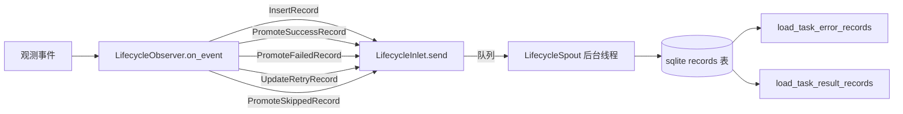

# tests/persist/test_lifecycle.py

> 📅 最后更新日期: 2026/11/13

## 作用

验证 `celestialflow.persist.core_lifecycle` 中 `LifecycleObserver` 的生命周期持久化能力：观察者把 `TaskInputEvent` / `TaskSuccessEvent` / `TaskFailEvent` / `TaskRetryEvent` / `TaskSkipEvent` 翻译为 dataclass 记录，经 `LifecycleInlet.send()` 投递到后台 `LifecycleSpout`，最终写入 sqlite 文件；同时验证 task-error / task-result 回读、重试次数持久化与旧库自动补列。

## 核心测试对象

| 类 / 对象 | 来源 | 说明 |
|-----------|------|------|
| `LifecycleObserver` | `celestialflow.persist.core_lifecycle` | 观察者门面：内部创建并绑定 `LifecycleSpout` 与 `LifecycleInlet`，提供 `start()` / `stop()` / `db_path`，在 `on_event(event)` 中把事件翻译为生命周期记录 |
| `LifecycleRecord` | `celestialflow.persist.core_lifecycle` | 记录联合类型，成员为下列 5 个不可变 dataclass |
| `InsertRecord` | `celestialflow.persist.core_lifecycle` | `TaskInputEvent` → 写入一条 `pending` 记录（`event_id` / `ts` / `node` / `task`） |
| `PromoteSuccessRecord` | `celestialflow.persist.core_lifecycle` | 把 pending 晋升为 `success` 并写入结果（保留原 `event_id`） |
| `PromoteFailedRecord` | `celestialflow.persist.core_lifecycle` | 把 pending 晋升为 `failed`，`event_id` 切换为失败事件的 `error_id`，并写入错误类型 / 消息 |
| `PromoteSkippedRecord` | `celestialflow.persist.core_lifecycle` | 把 pending 晋升为 `skipped`，`event_id` 切换为跳过事件的 `skip_id` |
| `UpdateRetryRecord` | `celestialflow.persist.core_lifecycle` | 更新 pending 记录的重试次数与最近一次错误信息，状态仍为 `pending` |
| `LifecycleSpout` / `LifecycleInlet` | `celestialflow.persist.core_lifecycle` | 后台 sqlite 写入器与记录入口；由 `LifecycleObserver` 内部装配，测试不直接实例化 |
| `load_task_error_records` / `load_task_result_records` | `celestialflow.persist.util_sqlite` | 按节点读取 task-error / task-result 对 |
| `connect_db` | `celestialflow.persist.util_sqlite` | 建立连接并负责表结构升级（如为旧库补 `retry_times` 列） |
| 事件类型 | `celestialflow.observer` | `TaskInputEvent` / `TaskSuccessEvent` / `TaskFailEvent` / `TaskRetryEvent` / `TaskSkipEvent` |

## 记录映射

| 事件 | 产生的记录 | 落库语义 |
|------|-----------|---------|
| `TaskInputEvent` | `InsertRecord(event_id=event.input_id, ts, node, task)` | 新增 `status="pending"` 行 |
| `TaskSuccessEvent` | `PromoteSuccessRecord(event_id=event.task_id, ts, result)` | `status="success"`，保留原 `event_id`，清空错误字段，写 `result_json` |
| `TaskFailEvent` | `PromoteFailedRecord(event_id=event.task_id, error_id=event.error_id, ts, error_type, error_message)` | `status="failed"`，`event_id` 替换为 `error_id` |
| `TaskRetryEvent` | `UpdateRetryRecord(event_id=event.task_id, ts, retry_times, error_type, error_message)` | 仅更新 `retry_times` / 最近错误 / `ts`，状态仍为 `pending` |
| `TaskSkipEvent` | `PromoteSkippedRecord(event_id=event.task_id, skip_id=event.skip_id, ts)` | `status="skipped"`，`event_id` 替换为 `skip_id`，清空错误字段 |

## 测试覆盖矩阵

| 测试类 | 用例数 | 覆盖目标 |
|--------|--------|---------|
| `TestLifecyclePersistence` | 5 | 完整生命周期持久化、成功结果持久化、重试次数持久化、跳过持久化、旧库补列 |

## 关键测试场景

### `test_lifecycle_persistence`

覆盖 `TaskInputEvent` → `TaskFailEvent` 与 `TaskInputEvent` → `TaskSuccessEvent` 两条链路（s1 / s2 两个节点）。

- 调用 `LifecycleObserver.start()` 启动后台写入线程并创建 `.sqlite3` 文件。
- s1：输入（`input_id=1`）写入 pending，随后失败事件（`task_id=1`、`error_id=21`）把记录晋升为 failed；最终落库 `event_id` 为 21，并绑定 `("ValueError", "oops")`。
- s2：输入（`input_id=2`）后成功事件（`task_id=2`、`success_id=3`）晋升为 success，保留 `event_id=2` 并写入结果 `"ok2"`。
- `finally` 中调用 `stop()`，确保事务提交、连接关闭。
- 断言 `db_path` 存在且后缀为 `.sqlite3`；`load_task_error_records(db_path, "s1")` 返回 `[("data1", ("ValueError", "oops"))]`。
- 直接查询 `records` 表并按 `id` 排序，验证 `event_id` 序列为 `[21, 2]`（`node` / `status` / `error_type` / `error_message` / `task_json` / `result_json` 逐字段核对），且两条记录的 `ts` 均大于 0。

### `test_success_persistence`

- 对 s1、s2 分别发送输入 + 成功事件（结果 100 / 200）。
- 断言 `load_task_result_records(db_path, "s1")` 返回 `[("task1", 100)]`。

### `test_retry_persistence`

- s1：输入 → 两次 `TaskRetryEvent`（`retry_times` 1、2）→ 成功事件；晋升 success 时清空错误信息并保留 `retry_times == 2`。
- s2：输入 → 两次 `TaskRetryEvent` → 失败事件；failed 记录保留最新错误信息（`ValueError` / `final boom`）且 `retry_times == 2`。
- 断言 `records` 表中 `(event_id, status, retry_times)` 为 `[(1, "success", 2), (22, "failed", 2)]`；成功记录错误字段为空，失败记录 `result_json` 为 `null`。

### `test_skip_persistence`

- s1：输入（`input_id=1`）+ 跳过事件（`task_id=1`、`skip_id=31`），记录晋升为 `skipped` 且 `event_id` 切换为 31。
- s2：输入 + 成功事件，作为对照。
- 断言 `[(event_id, status)]` 为 `[(31, "skipped"), (2, "success")]`，跳过记录错误字段为空、`result_json` 为 `null`。

### `test_old_db_gets_retry_times_column`

- 手工创建一个不含 `retry_times` 列的 `records` 表。
- 调用 `connect_db(db_path)` 后，通过 `PRAGMA table_info(records)` 断言 `retry_times` 列已被自动补齐。

## 数据流



## 运行方式

```bash
# 全部执行
pytest tests/persist/test_lifecycle.py -v

# 按关键字匹配
pytest tests/persist/test_lifecycle.py -k "lifecycle" -v
pytest tests/persist/test_lifecycle.py -k "success" -v
pytest tests/persist/test_lifecycle.py -k "retry" -v
pytest tests/persist/test_lifecycle.py -k "skip" -v
```

## 注意事项

- 测试通过 `monkeypatch.chdir(tmp_path)` 把工作目录切到临时目录，sqlite 文件写入临时目录下的 `lifecycles/<日期>/`，测试结束后自动清理。
- 每个用例都显式 `start()` / `stop()` 观察者；`stop()` 会提交剩余事务并关闭 sqlite 连接。
- 失败 / 跳过记录的落库 `event_id` 会被替换为最终状态事件携带的事件 ID（`error_id` / `skip_id`），保持后续错误查询 / 推送语义一致。
- `LifecycleInlet` / `LifecycleSpout` 由 `LifecycleObserver` 在内部成对创建，测试不直接碰队列，入队统一走 `LifecycleInlet.send(record)`。
- 相关实现在 `src/celestialflow/persist/core_lifecycle.py`。
