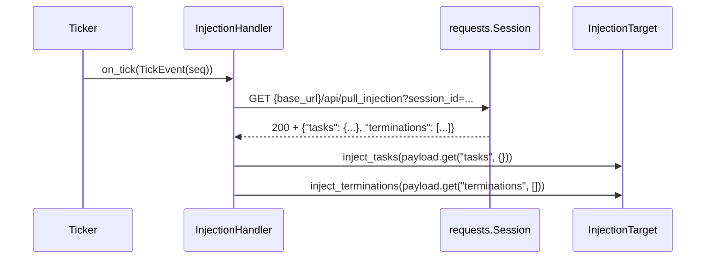

# tests/reporter/test_inject.py

> 📅 最后更新日期: 2026/11/13

## 作用

验证 `celestialflow.reporter.InjectionHandler` 的远端注入拉取行为：按节拍 GET `/api/pull_injection`，把返回的任务映射与终止符序列依次交给 `InjectionTarget`；覆盖拉取失败、注入失败与节拍缩放三种路径。

## 核心测试对象

| 对象 | 来源 | 说明 |
|------|------|------|
| `InjectionHandler` | `celestialflow.reporter` | 节拍处理器，`tick_period = 5` |
| `InjectionTarget` | `celestialflow.reporter` | 协议：`inject_tasks(Mapping[str, Iterable[Any]])` + `inject_terminations(Sequence[str])` |
| `TickEvent` | `celestialflow.ticker` | 测试直接构造，不依赖真实节拍器 |
| `ReporterError` | `celestialflow.runtime.util_errors` | 拉取返回非 2xx 时的预期异常 |

## 关键 fixture 与假对象

| 名称 | 用途 |
|------|------|
| `FakeResponse` | 模拟成功响应：`ok = True`、`status_code = 200`、`json()` 返回预设载荷 |
| `FakeFailResponse` | 模拟失败响应：`ok = False`、`status_code = 500`、`json()` 返回 `{}`（不应被调用） |
| `FakeSession` | `requests.Session` 替身，记录 `(url, params, timeout)` 三元组到 `gets`，返回构造时传入的响应 |
| `FakeTarget` | `InjectionTarget` 替身，把每次注入的 `tasks` / `terminations` 追加到列表，便于断言“注入了几次、内容是什么” |
| `make_event(seq)` | 构造 `seq` 指定、其余时间字段固定为 `0.0` 的 `TickEvent` |
| `RaisingTarget`（用例内局部类） | 继承 `FakeTarget`，`inject_tasks` 抛 `RuntimeError("unknown node")` |

## 测试覆盖矩阵

| 用例 | 覆盖目标 |
|------|---------|
| `test_injection_handler_pulls_and_injects` | 拉取地址、查询参数、任务与终止符的注入顺序 |
| `test_injection_handler_raises_on_pull_failure` | 非 2xx 抛 `ReporterError`，且不执行任何注入 |
| `test_injection_handler_propagates_inject_failure` | 任务注入异常向上传播，终止符注入不再执行 |
| `test_injection_handler_tick_period_is_five` | `tick_period == 5`，命中节拍为 `1, 6, 11, ...` |

## 关键行为细节

### 一次成功拉取



- **URL**：`f"{base_url}/api/pull_injection"`。
- **查询参数**：仅 `{"session_id": session_id}`；测试断言 `params["session_id"] == "g1"`。
- **超时**：模块常量 `_PULL_TIMEOUT = 3.0`，`FakeSession.get` 将其记录为第三个元素（测试只用 `_timeout` 占位，不断言具体值）。
- **注入顺序**：先 `inject_tasks`，后 `inject_terminations`。若 `tasks` 注入抛异常，则 `terminations` 不会执行——`test_injection_handler_propagates_inject_failure` 用 `target.terminations == []` 证明这一点，同时用 `pytest.raises(RuntimeError, match="unknown node")` 确认原异常未被包装。
- **缺省键**：载荷缺失时使用 `.get("tasks", {})` 与 `.get("terminations", [])` 的默认空值（本文件未直接覆盖，但属于被测实现的契约）。

### 拉取失败

- `FakeFailResponse.ok is False` 时，处理器在调用 `json()` 之前抛出 `ReporterError("Failed to pull task injection: 500")`。
- 测试断言 `target.tasks == []` 且 `target.terminations == []`，即失败路径不会产生半截注入。
- 异常最终由节拍器的处理器异常隔离机制消费（`TickHandler.handle_exception`），不影响后续节拍；测试只验证处理器本身抛出。

### 节拍缩放

`InjectionHandler.tick_period = 5`，基类 `should_tick` 使用 `(event.seq - 1) % tick_period == 0`：

| seq | 1 | 2 | 3 | 4 | 5 | 6 | 7 | 8 | 9 | 10 | 11 |
|-----|---|---|---|---|---|---|---|---|---|----|----|
| 命中 | ✅ | ❌ | ❌ | ❌ | ❌ | ✅ | ❌ | ❌ | ❌ | ❌ | ✅ |

以 `Ticker` 的 1 秒基准周期运行时，等效为每 5 秒拉取一次。测试直接遍历 `range(1, 12)` 调用 `should_tick(make_event(seq))`，不启动节拍器。

## 运行方式

```bash
# 全部执行
uv run pytest tests/reporter/test_inject.py -v

# 仅失败路径
uv run pytest tests/reporter/test_inject.py -k "failure or propagates" -v
```

## 注意事项

- 全部网络交互由 `FakeSession` 替代，不产生真实 HTTP 请求，单文件执行应远低于 1 秒。
- `InjectionHandler` 不持有 `requests.Session` 的所有权，关闭由调用方（`run_graph_resources`）负责；测试中的假 session 无需关闭。
- `FakeTarget` 记录的是每次注入的完整对象，因此 `target.tasks == [{"StageA": [1, 2]}]` 同时验证了“只注入一次”和“载荷原样传递”。
- 相关实现见 `src/celestialflow/reporter/core_inject.py`，语义说明见 `docs/zh-CN/src/reporter/core_inject.md`。
