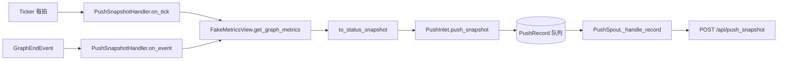

# tests/reporter/test_snapshot.py

> 📅 最后更新日期: 2026/11/13

## 作用

验证上报模块的状态快照链路：

- `to_status_snapshot()` 把 `NodeMetrics` 映射投影为推送载荷；
- `PushSnapshotHandler.on_tick()` 按拍读取整图指标并把 `kind="snapshot"` 记录交给 `PushInlet`；
- `PushSnapshotHandler.on_event(GraphEndEvent)` 在图结束时补推一次终态快照；
- 快照记录经 `PushSpout` 推送到 `/api/push_snapshot`。

## 核心测试对象

| 对象 | 来源 | 说明 |
|------|------|------|
| `to_status_snapshot(metrics)` | `celestialflow.reporter.core_snapshot` | 节点指标 → 状态字典的纯投影函数 |
| `PushSnapshotHandler` | `celestialflow.reporter` | 同时是 `TickHandler` 与 `Observer` |
| `PushInlet` / `PushSpout` / `PushRecord` | `celestialflow.reporter.core_push` | 快照入队与推送 |
| `GraphEndEvent` | `celestialflow.observer` | 触发终态补推的事件 |
| `NodeMetrics` / `NodeStatus` | `celestialflow.runtime.util_types` | 指标快照与节点状态枚举 |
| `TickEvent` | `celestialflow.ticker` | 直接构造，不启动节拍器 |

## 关键 fixture 与假对象

| 名称 | 用途 |
|------|------|
| `FakeMetricsView` | 实现 `get_node_metrics()` / `get_graph_metrics()` 的只读视图替身；`graph_calls` 记录 `get_graph_metrics()` 调用次数 |
| `FakePushSession` | 记录 POST 的 `requests.Session` 替身，`post()` 返回固定成功响应 |
| `make_metrics(node, *, succeeded=0)` | 构造 `NodeStatus.RUNNING` 的 `NodeMetrics`：`start_time=1.0`、`end_time=0.0`，`external_input` / `input_total` / `succeeded` / `processed` 均为 `succeeded` |
| `make_event(seq)` | 构造固定时间字段的 `TickEvent` |

## 测试覆盖矩阵

| 用例 | 覆盖目标 |
|------|---------|
| `test_to_status_snapshot_projects_node_metrics` | 投影输出的键集合与字段映射 |
| `test_handler_enqueues_snapshot_record` | `on_tick` 入队一条 `kind="snapshot"` 记录，且只读取一次整图指标 |
| `test_handler_pushes_final_snapshot_on_graph_end` | `GraphEndEvent` 触发一次终态快照补推 |
| `test_spout_pushes_snapshot_to_push_snapshot_endpoint` | `POST /api/push_snapshot` 的 URL 与载荷（`session_id` / `snapshot` / `timestamp`） |

## 关键行为细节

### 投影字段

`to_status_snapshot` 对每个节点输出以下键：

| 输出键 | 来源 `NodeMetrics` 字段 |
|--------|------------------------|
| `start_time` | `start_time` |
| `end_time` | `end_time` |
| `status` | `status`（`NodeStatus` 枚举，测试直接比较 `NodeStatus.RUNNING`） |
| `tasks_input` | `input_total` |
| `tasks_succeeded` | `succeeded` |
| `tasks_failed` | `failed` |
| `tasks_skipped` | `skipped` |
| `tasks_processed` | `processed` |
| `tasks_pending` | `pending` |
| `upstream_counts` | `upstream_counts` |
| `downstream_counts` | `downstream_counts` |

测试只断言其中的 `start_time` / `end_time` / `status` / `tasks_input` / `tasks_succeeded` / `upstream_counts` / `downstream_counts`，其余字段由同一字典推导式保证。

### 两条触发路径



- **节拍路径**：`on_tick` → `_push_snapshot()` → `to_status_snapshot(get_graph_metrics())` → `PushInlet.push_snapshot()`。测试断言 `record.kind == "snapshot"`、`record.snapshot["s1"]["tasks_succeeded"] == 2`、`view.graph_calls == 1`。
- **图结束路径**：`on_event` 用 `match` 只处理 `GraphEndEvent`，其余事件忽略。测试构造 `GraphEndEvent(graph="g1", end_time=2.0, elapsed=1.0)` 后断言立即入队一条快照、`graph_calls == 1`。
- 补推的意义：快照只在节拍上产生，而图收尾会先停 ticker，末拍与图结束之间的终态（节点全部 `STOPPED`、最终计数）不会被任何节拍捕获。`PushSnapshotHandler` 只做投影与入队，不进行网络 IO。

### 推送载荷

- 端点：`{base_url}/api/push_snapshot`。
- 载荷：`{"session_id": ..., "snapshot": {...}, "timestamp": time.time()}`。
- 测试用 `inlet.push_snapshot({"s1": {"status": 1}})` 直接入队，再调用 `spout._handle_record(spout.get_queue().get())`，断言 `payload["snapshot"] == {"s1": {"status": 1}}` 且 `payload["timestamp"] > 0`。

## 运行方式

```bash
# 全部执行
uv run pytest tests/reporter/test_snapshot.py -v

# 仅投影函数
uv run pytest tests/reporter/test_snapshot.py -k "status_snapshot" -v

# 仅处理器
uv run pytest tests/reporter/test_snapshot.py -k "handler" -v

# 仅端点推送
uv run pytest tests/reporter/test_snapshot.py -k "endpoint" -v
```

## 注意事项

- 测试不启动 `Ticker`，直接调用 `on_tick` / `on_event`，因此不存在时序抖动。
- `FakeMetricsView.graph_calls` 用来确认一次触发只读取一次整图指标，避免处理器内部重复快照导致载荷不一致或额外开销。
- 处理器构造参数为 `(metrics_view, inlet)`，其中 `inlet` 必须已 `bind_spout`；测试用 `PushInlet().bind_spout(spout)` 建立绑定。
- `spout._session` 直接赋假会话以绕过 `start()`，与 `test_push.py` 的做法一致。
- 相关实现见 `src/celestialflow/reporter/core_snapshot.py`，语义说明见 `docs/zh-CN/src/reporter/core_snapshot.md`。
