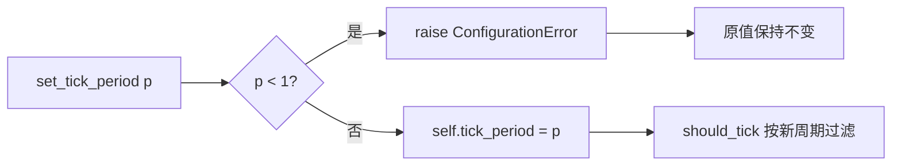

# tests/ticker/test_handler.py

> 📅 最后更新日期: 2026/11/13

## 作用

验证 `celestialflow.ticker.TickHandler` 的节拍过滤基础语义：默认 `tick_period`、运行期调整后的 `should_tick()` 行为、相位重锚定，以及非正周期的参数校验。

## 核心测试对象

| 对象 | 来源 | 说明 |
|------|------|------|
| `TickHandler` | `celestialflow.ticker` | 节拍处理器基类，`tick_period: int = 1` |
| `TickHandler.should_tick(event)` | 同上 | 命中条件为 `(event.seq - 1) % tick_period == 0` |
| `TickHandler.set_tick_period(period)` | 同上 | 运行期修改周期，非法值抛 `ConfigurationError` |
| `TickEvent` | `celestialflow.ticker` | 只需 `seq` 参与过滤；测试其余时间字段填固定值 |
| `ConfigurationError` | `celestialflow.runtime.util_errors` | 非正周期的预期异常 |

## 关键 fixture 与辅助函数

| 名称 | 用途 |
|------|------|
| `make_event(seq)` | 构造 `seq` 指定、`interval=1.0`、`scheduled_at=fired_at=wall_time=float(seq)`、`drift=0.0`、`skipped=0` 的事件 |
| `BareHandler` | 只实现 `on_tick` 的最简子类，不覆写 `tick_period`，用于观察默认值与运行期调整 |
| `hit_seqs(handler, upto)` | 对 `1..upto` 逐拍调用 `handler.should_tick(make_event(seq))`，返回命中序号列表 |

> 测试不启动 `Ticker`，也不依赖 `TickHub`，只直接调用基类方法，因此完全同步、无时序抖动。

## 测试覆盖矩阵

| 用例 | 覆盖目标 |
|------|---------|
| `test_handler_default_tick_period_is_one` | 默认 `tick_period == 1`，1~5 拍全部命中 |
| `test_set_tick_period_takes_effect_on_should_tick` | `set_tick_period(2)` → 命中 `1,3,5,7`；再设 3 → 命中 `1,4,7` |
| `test_set_tick_period_rejects_non_positive` | `set_tick_period(0)` 抛 `ConfigurationError`，且原值 `3` 保持不变 |

## 关键行为细节

### 过滤公式与相位

`should_tick` 以 `seq - 1` 为基准取模，因此**第 1 拍对任何合法周期都命中**。调整周期后不会从“当前拍”重新计数，而是重新锚定到 `seq == 1`：

| 周期 | 命中序号（1 起） |
|:----:|------------------|
| 1 | 1, 2, 3, 4, 5, 6, 7 |
| 2 | 1, 3, 5, 7 |
| 3 | 1, 4, 7 |

测试先 `set_tick_period(2)` 验证 `[1, 3, 5, 7]`，再 `set_tick_period(3)` 验证 `[1, 4, 7]`——注意第 2 次调整发生在 `seq` 未推进的同一对象上，结果仍按 `seq == 1` 锚定，说明相位只由 `seq` 决定，与调用时机无关。

### 参数校验

`set_tick_period(0)` 在赋值前检查 `< 1` 并抛 `ConfigurationError("tick_period must be a positive integer, got 0")`。测试先设为 3，再触发异常，最后断言 `handler.tick_period == 3`，证明失败调用不会污染原状态。



## 运行方式

```bash
# 全部执行
uv run pytest tests/ticker/test_handler.py -v

# 仅默认值
uv run pytest tests/ticker/test_handler.py -k "default" -v

# 仅运行期调整
uv run pytest tests/ticker/test_handler.py -k "set_tick_period" -v
```

## 注意事项

- 这些用例执行时间在毫秒级，无需等待任何后台线程。
- `BareHandler.on_tick` 为空实现，`should_tick` 由基类提供；若将来基类改变过滤公式（例如改为 `seq % period`），本文件的命中序列断言会立即失败。
- `TickHandler.handle_exception` 的默认行为（打印回溯）不在本文件覆盖范围内，相关用例见 `test_hub.md` 与 `test_ticker.md`。
- 相关实现见 `src/celestialflow/ticker/core_handler.py`，语义说明见 `docs/zh-CN/src/ticker/core_handler.md`。
