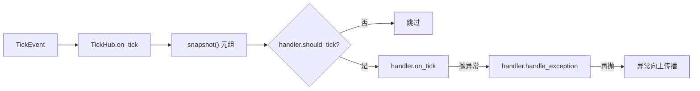

# tests/ticker/test_hub.py

> 📅 最后更新日期: 2026/11/13

## 作用

验证 `celestialflow.ticker.TickHub` 的分发与管理语义：

- 同一拍向全部已注册处理器扇出；
- 各处理器按自身 `tick_period` 独立过滤；
- 运行期 `set_tick_period` 立即影响后续分发；
- 拒绝注册自身、拒绝形成循环引用的 hub、拒绝非法 `tick_period`；
- 单个处理器回调抛异常时隔离到该处理器自身的 `handle_exception`，不阻断其余处理器。

## 核心测试对象

| 对象 | 来源 | 说明 |
|------|------|------|
| `TickHub` | `celestialflow.ticker` | 本身是 `TickHandler`，持有处理器元组并以写时复制更新 |
| `TickHub.add_handler(handler)` | 同上 | 校验 `tick_period`、检测循环引用后追加 |
| `TickHub.on_tick(event)` | 同上 | 遍历快照，过滤后逐个调用 `on_tick`，异常交给该处理器的 `handle_exception` |
| `TickHandler` | `celestialflow.ticker` | 处理器基类 |
| `ConfigurationError` | `celestialflow.runtime.util_errors` | 注册非法处理器时的预期异常 |

## 关键 fixture 与假对象

| 名称 | 用途 |
|------|------|
| `make_event(seq)` | 构造 `seq` 指定、其余时间字段等于 `float(seq)` 的 `TickEvent` |
| `RecordingHandler(tick_period=1)` | 在 `__init__` 中直接赋值 `self.tick_period`（不经 `set_tick_period`），把命中的 `event.seq` 追加到 `seqs` |
| `FailingHandler`（用例内局部类） | `on_tick` 抛 `RuntimeError("boom")`，覆写 `handle_exception` 收集异常到 `errors` |

## 测试覆盖矩阵

| 用例 | 覆盖目标 |
|------|---------|
| `test_hub_fans_out_to_all_handlers` | 注册两个处理器，单拍二者都收到 `seq == 1` |
| `test_hub_filters_by_tick_period` | 周期 1 与周期 2 的处理器各自命中：`[1,2,3,4,5]` vs `[1,3,5]` |
| `test_hub_picks_up_runtime_tick_period_change` | 运行中改为周期 3 后，后续仅 `4, 7` 命中，累计 `[1,2,3,4,7]` |
| `test_hub_rejects_self_registration` | `hub.add_handler(hub)` 抛 `ConfigurationError` |
| `test_hub_rejects_cycle_registration` | `a.add_handler(b)` 后 `b.add_handler(a)` 抛 `ConfigurationError` |
| `test_hub_rejects_invalid_tick_period` | 注册 `tick_period=0` 的处理器抛 `ConfigurationError` |
| `test_hub_isolates_handler_exceptions` | 失败处理器的异常被自身收集，后续处理器仍收到该拍 |

## 关键行为细节

### 分发与过滤

`TickHub.on_tick` 遍历 `_snapshot()`（当前处理器元组的引用），对每个处理器先调用 `should_tick(event)`，命中才调用 `on_tick(event)`。因此 hub 自身不需要计数，周期语义完全由 `TickHandler` 提供。

`test_hub_filters_by_tick_period` 连续投递 `seq = 1..5`：

| 处理器 | `tick_period` | 命中序列 |
|--------|:-------------:|----------|
| `every` | 1 | 1, 2, 3, 4, 5 |
| `every_other` | 2 | 1, 3, 5 |

### 运行期调整

先以周期 1 投递 `1..3`，处理器记录 `[1,2,3]`；随后 `handler.set_tick_period(3)`，再投递 `4..9`。由于过滤公式为 `(seq - 1) % 3 == 0`，命中的是 `4` 与 `7`，最终 `seqs == [1, 2, 3, 4, 7]`。



### 注册校验

- **非法周期**：`add_handler` 首先调用 `validate_tick_period(handler)`，`tick_period < 1` 直接抛 `ConfigurationError`。
- **自身注册**：`handler is self` 时抛 `ConfigurationError("cannot register a TickHub into itself")`。
- **循环引用**：仅当待注册对象是 `TickHub` 时做深度遍历。`test_hub_rejects_cycle_registration` 先建立 `a → b`，再尝试 `b → a`；此时从待注册的 `a` 出发遍历其后代（含 `b`），发现 `self`（即 `b`）已在链中，说明 `b → a` 会成环，抛出循环错误。遍历使用 `seen` 集合避免重复访问。
- 测试只覆盖直接环（长度 2），间接环由同一遍历逻辑保证。

### 异常隔离

`test_hub_isolates_handler_exceptions` 注册 `FailingHandler` 与 `RecordingHandler` 后投递一拍：

- `FailingHandler.on_tick` 抛 `RuntimeError("boom")`；
- hub 捕获后调用 `failing.handle_exception(e)`，异常被追加到 `failing.errors`；
- 循环继续，`ok.seqs == [1]`。

若 `handle_exception` 自身再抛异常，hub 不再捕获，异常向上传播给驱动它的 `Ticker`（见 `test_ticker.md` 的兜底用例）。

## 运行方式

```bash
# 全部执行
uv run pytest tests/ticker/test_hub.py -v

# 仅分发与过滤
uv run pytest tests/ticker/test_hub.py -k "fans_out or filters or runtime" -v

# 仅注册校验
uv run pytest tests/ticker/test_hub.py -k "rejects" -v

# 仅异常隔离
uv run pytest tests/ticker/test_hub.py -k "isolates" -v
```

## 注意事项

- 所有用例直接调用 `hub.on_tick(...)`，不启动后台线程，执行时间在毫秒级。
- `RecordingHandler` 在 `__init__` 中直接写 `self.tick_period`，绕过了 `set_tick_period` 的校验；因此 `tick_period=0` 能被构造出来，用于验证 `add_handler` 的注册期校验。
- 写时复制（copy-on-write）设计未在本文件直接断言并发安全，只通过注册/分发行为间接覆盖。
- 相关实现见 `src/celestialflow/ticker/core_hub.py`，语义说明见 `docs/zh-CN/src/ticker/core_hub.md`。
