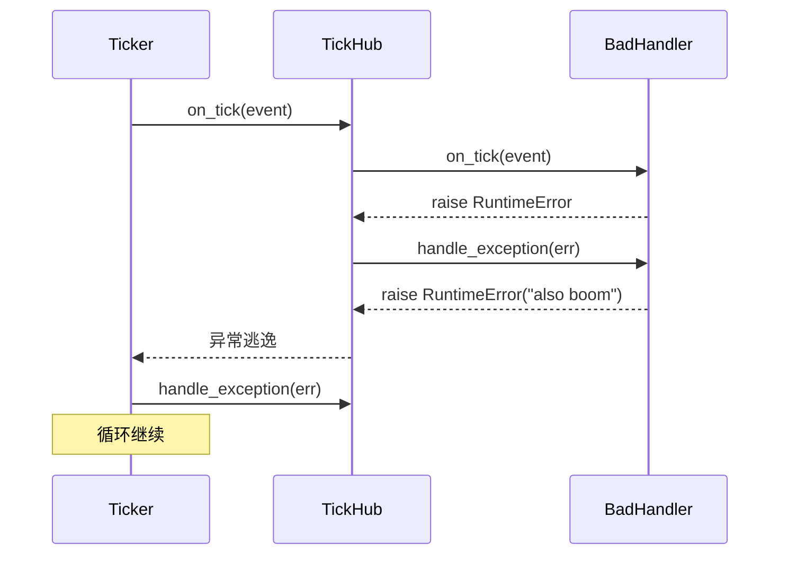

# tests/ticker/test_ticker.py

> 📅 最后更新日期: 2026/11/13

## 作用

验证 `celestialflow.ticker.Ticker` 的端到端时间驱动行为：周期触发与停止、`tick_period` 缩放、运行期调速、超时跳拍、处理器异常隔离、以 `TickHub` 为根时的兜底，以及非正周期校验。

> 本文件是 ticker 区域中唯一使用真实后台线程与真实时间的测试，但所有周期都在 `0.01~0.05` 秒量级，并通过 `wait_until` / `assert_stays_true` 设置明确超时，整体应在数秒内完成。

## 核心测试对象

| 对象 | 来源 | 说明 |
|------|------|------|
| `Ticker(interval, handler, *, name="ticker")` | `celestialflow.ticker` | 基于 `time.monotonic()` 锚定计划时刻的后台节拍器 |
| `Ticker.start()` / `stop()` / `is_running()` | 同上 | 生命周期控制；首拍在一个周期后触发 |
| `Ticker.get_interval()` / `set_interval(v)` | 同上 | 调速；`set_interval` 唤醒等待并重新锚定 |
| `TickHandler` / `TickHub` / `TickEvent` | `celestialflow.ticker` | 处理器、分发中心、节拍事件 |
| `ConfigurationError` | `celestialflow.runtime.util_errors` | 非正周期的预期异常 |

## 关键 fixture 与假对象

| 名称 | 用途 |
|------|------|
| `wait_until(cond, *, timeout=5.0, ...)` | 来自 `tests/conftest.py`，轮询等待后台线程产生预期事件；失败时 `pytest.fail` |
| `assert_stays_true(cond, *, duration=0.3, ...)` | 在一段时间内持续验证条件，用于确认“停止后不再触发” |
| `RecordingHandler(tick_period=1)` | 记录收到的 `TickEvent` 到 `events` |
| `SlowHandler`（用例内局部类） | 每拍 `time.sleep(0.05)`，用于制造超时跳拍 |
| `FailingHandler`（用例内局部类） | 每拍计数并抛 `RuntimeError`，`handle_exception` 收集异常 |
| `BadHandler` + `RecordingHub`（用例内局部类） | `on_tick` 与 `handle_exception` 均抛异常；hub 覆写 `handle_exception` 收集兜底异常 |

## 测试覆盖矩阵

| 用例 | 覆盖目标 |
|------|---------|
| `test_ticker_fires_periodically_and_stops` | 周期触发、`seq` 从 1 连续递增、停止后不再产生新事件 |
| `test_ticker_honors_handler_tick_period` | 处理器 `tick_period=2` 时只收到奇数拍 |
| `test_ticker_set_interval_takes_effect` | 30 秒周期下无事件，`set_interval(0.02)` 后立即触发 |
| `test_ticker_reports_skipped_ticks_on_overrun` | 单拍耗时超过周期时 `TickEvent.skipped > 0` |
| `test_ticker_isolates_handler_exceptions` | 回调异常交给自身 `handle_exception`，节拍循环继续 |
| `test_ticker_backstops_handler_exception_via_root_hub` | 子处理器 `handle_exception` 再抛时由根 hub 兜底，线程存活 |
| `test_ticker_rejects_non_positive_interval` | 构造与 `set_interval` 的非正值均抛 `ConfigurationError` |

## 关键行为细节

### 周期触发与停止

```python
handler = RecordingHandler()
ticker = Ticker(0.02, handler)

ticker.start()
wait_until(lambda: len(handler.events) >= 3, timeout=2.0)
ticker.stop()

assert not ticker.is_running()
assert [event.seq for event in handler.events] == list(range(1, len(handler.events) + 1))
```

- `start()` 仅在后台线程未存活时创建并启动 daemon 线程；首拍要等一个完整周期。
- `stop()` 置停止标志、`notify_all`、`join`（最长 5 秒），成功后把线程引用置空。
- 停止后再观察 `0.1` 秒，事件数量保持不变，证明循环已退出而非短暂停顿。

### `tick_period` 缩放

`Ticker` 在 `_dispatch` 中先调用根处理器的 `should_tick(event)`。`RecordingHandler(tick_period=2)` 命中 `(seq - 1) % 2 == 0`，即 `seq = 1, 3, 5, ...`。测试启动后等待至少 2 个事件，随后断言 `all(event.seq % 2 == 1 for event in handler.events)`。

### 运行期调速

```python
ticker = Ticker(30.0, handler)
ticker.start()
assert handler.events == []      # 30 秒周期，短时间内不应触发
ticker.set_interval(0.02)
wait_until(lambda: len(handler.events) >= 1, timeout=2.0)
```

`set_interval` 在条件变量保护下更新 `_interval` 并 `notify_all`；循环被唤醒后读取新周期，若已到点立即触发，否则重新等待。测试最后断言 `ticker.get_interval() == 0.02`。

### 超时跳拍

`SlowHandler.on_tick` 每拍睡眠 `0.05` 秒，而 `Ticker` 周期为 `0.01` 秒。循环计算：

```text
lateness = fired - scheduled
skipped  = int(lateness // interval)   # lateness > 0 时
prev_fire = scheduled + skipped * interval
```

因此每拍会跳过多个错过的周期，`skipped` 写入 `TickEvent`。测试等待 `any(event.skipped > 0)`，最多 3 秒，不做追赶式补发（避免请求风暴）。

### 两层异常隔离

| 场景 | 行为 |
|------|------|
| 处理器 `on_tick` 抛异常 | `Ticker._dispatch` 捕获并调用该处理器的 `handle_exception`，循环继续 |
| 处理器 `handle_exception` 也抛异常，且根处理器是 `TickHub` | 异常从 `hub.on_tick` 逃逸，`Ticker._dispatch` 捕获后调用**根 hub** 的 `handle_exception` 兜底，循环继续 |
| 根处理器不是 `TickHub`，且其 `handle_exception` 再抛 | 异常逃逸出 `_dispatch`，后台线程终止（本文件未直接覆盖） |

`test_ticker_isolates_handler_exceptions` 等待 `handler.count >= 3 and len(handler.errors) >= 3`，证明连续失败后仍持续触发。

`test_ticker_backstops_handler_exception_via_root_hub` 的子处理器 `BadHandler` 在 `handle_exception` 中再次抛 `RuntimeError("also boom")`；根为 `RecordingHub`（覆写 `handle_exception` 收集异常），测试等待 `len(hub.fallbacks) >= 1` 并断言 `ticker.is_running()` 仍为真。



### 参数校验

- `Ticker(0.0, handler)` 在构造时抛 `ConfigurationError`；`interval <= 0` 一律拒绝。
- `set_interval(-1.0)` 同样抛 `ConfigurationError`。
- 构造时还会调用 `validate_tick_period(handler)`，根处理器周期非法也会被拒绝（本文件用 `RecordingHandler` 的合法默认值，未单独覆盖）。

## 运行方式

```bash
# 全部执行
uv run pytest tests/ticker/test_ticker.py -v

# 仅生命周期
uv run pytest tests/ticker/test_ticker.py -k "fires or stops" -v

# 仅调速与跳拍
uv run pytest tests/ticker/test_ticker.py -k "interval or skipped" -v

# 仅异常隔离
uv run pytest tests/ticker/test_ticker.py -k "exception" -v
```

## 注意事项

- 所有后台线程都在 `try/finally` 中 `stop()`，避免用例失败后泄漏线程。
- 断言不依赖精确触发次数，只使用 `>=` 或“全部为奇数”这类稳定性质；超时统一由 `wait_until` 控制，避免固定 `sleep`。
- `assert_stays_true(duration=0.1)` 用于确认停止后不再触发；若机器调度导致误报，应调整实现而不是放宽断言。
- `Ticker.stop()` 对未启动（`_thread is None`）是空操作；对无法在 5 秒内退出的线程抛 `RuntimeStateError`。
- 相关实现见 `src/celestialflow/ticker/core_ticker.py`，语义说明见 `docs/zh-CN/src/ticker/core_ticker.md`。
